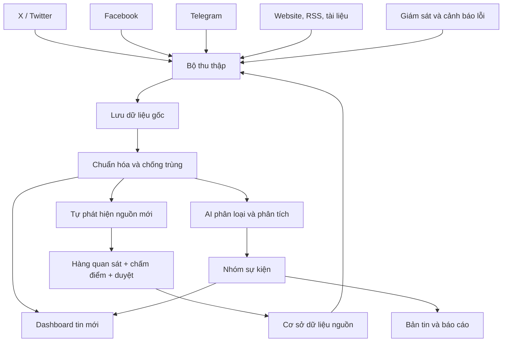

# OSINT Dashboard 1.0 — Thẩm định & kiến trúc đề xuất

Tài liệu này là phần Claude Code phản hồi đề xuất nghiệp vụ: kiểm chứng tính khả thi, chọn công nghệ, chốt lộ trình. Trạng thái: **bản nháp chờ chủ dự án duyệt** (xem mục 10).

## 1. Kết luận thẩm định

Hướng đi đúng: **ingest thô trước, AI sau** (tách hai đường), **lưu bằng chứng tách khỏi sự kiện**, **xây theo giai đoạn**. Giữ nguyên ba nguyên tắc này.

Cần chỉnh/bổ sung:

| # | Điểm trong đề xuất | Vấn đề | Điều chỉnh |
|---|---|---|---|
| 1 | "6 phân hệ" | Văn bản chỉ nêu 5 nhiệm vụ, không liệt kê 6 phân hệ | Đề xuất 6 phân hệ ở mục 2 |
| 2 | "Tự tìm tài khoản/kênh mới và tự bổ sung vào diện theo dõi" | Tự thêm nguồn là cửa cho nhiễu và tin giả/chiến dịch thao túng thông tin; X/Facebook/Telegram không có API khám phá miễn phí | Nguồn mới vào hàng **quan sát (probation)**, chấm điểm, người duyệt mới lên diện chính thức. Tự động hóa việc *đề xuất*, không tự động hóa việc *chấp nhận* |
| 3 | "Phát hiện mọi bài đăng ngay khi thu thập" | Độ trễ phụ thuộc loại nguồn; X và Facebook không có đường truy cập ổn định, rẻ, hợp điều khoản; scrape trái điều khoản dịch vụ | Phân tầng nguồn theo phương thức truy cập (mục 4), đặt SLO độ trễ riêng cho từng tầng |
| 4 | "Đề xuất nhận định" bằng AI | Rủi ro AI khẳng định thông tin chưa kiểm chứng | Mọi nhận định phải kèm trích dẫn bằng chứng, nhãn độ tin cậy, tách "dữ kiện" khỏi "suy luận" |
| 5 | Thiếu | Không nhắc: lưu trữ bất biến bài gốc (bài bị xóa), điểm tin cậy nguồn, phân quyền/nhật ký truy cập, đo chất lượng | Bổ sung ở mục 2, 5, 7 |

Giới hạn trung thực (giữ nguyên lời đề xuất): hệ thống không thể phủ mọi thứ trên Internet; mục tiêu là tối đa độ bao phủ và tối thiểu độ trễ **trong phạm vi nguồn truy cập hợp pháp, khả dụng**. Nên đo và công bố độ bao phủ thực tế trên bộ nguồn chuẩn.

## 2. Sáu phân hệ

1. **Collector** — thu thập đa phương thức, chạy độc lập từng nguồn, ghi bản ghi thô.
2. **Source Registry & Discovery** — danh mục nguồn, tầng ưu tiên, điểm tin cậy, sức khỏe nguồn, đề xuất nguồn mới.
3. **Evidence Store** — lưu bất biến: nội dung thô, snapshot trang (WARC/HTML), media, hash, thời điểm thu thập.
4. **Dedup & Event Clustering** — chống trùng nhiều lớp, gom bằng chứng thành nhóm sự kiện.
5. **AI Analysis** — dịch, phân loại, tóm tắt, trích xuất thực thể/dữ kiện, nhận định có dẫn chứng.
6. **Dashboard & Reporting** — luồng tin, nhóm sự kiện, tìm kiếm, cảnh báo, bản tin 07:00/11:00/18:00, báo cáo chuyên đề.

Giám sát & cảnh báo lỗi là tính năng xuyên suốt, không tính là phân hệ riêng.

## 3. Sơ đồ luồng dữ liệu

Sơ đồ nghiệp vụ của chủ dự án được giữ làm gốc; phần in đậm là chỗ Claude Code bổ sung.



Điểm khác sơ đồ gốc:

- **Hàng quan sát (P)** chen giữa "Tự phát hiện nguồn mới" và "Cơ sở dữ liệu nguồn": nguồn mới chỉ được theo dõi thử ở mức thấp, tích lũy điểm tin cậy/độ liên quan, rồi người duyệt mới lên diện chính thức.
- **Lưu dữ liệu gốc (F)** phải bất biến và chạy ngay sau thu thập; hiển thị lên dashboard không phụ thuộc AI.
- **Nhóm sự kiện (L)** chạy sau phân tích AI và embedding, nhưng dashboard (H) vẫn nhận tin thô từ G trước đó. Tin hiện ở trạng thái "chưa phân tích" rồi được làm giàu dần.
- **Giám sát (N)** theo dõi cả Collector lẫn *từng nguồn* (nguồn im lặng bất thường), không chỉ tiến trình.

Luồng tuần tự:

```
Nguồn ─► Collector ─► raw_item (lưu ngay, hiển thị ngay)
                          │
                          ├─► Dedup lớp 1-2 (đồng bộ, rẻ)  ─► evidence + event_group tạm
                          │
                          └─► hàng đợi ─► Embedding ─► Cluster sự kiện (lớp 3)
                                      └─► AI Analysis (dịch/phân loại/tóm tắt/trích xuất)
                                                    └─► Dashboard, cảnh báo, bản tin
```

## 4. Thu thập và độ trễ

| Tầng | Phương thức | Ví dụ | Độ trễ mục tiêu |
|---|---|---|---|
| A — đẩy/thời gian thực | Telegram MTProto (kênh công khai), Bluesky Jetstream, Mastodon streaming, WebSub | Kênh Telegram quân sự | giây → < 1 phút |
| B — thăm dò thích ứng | RSS/Atom, sitemap, trang tin có HTML ổn định; conditional GET (ETag/Last-Modified) | Bộ/ngành quốc phòng, báo quốc phòng, think tank | 1–5 phút theo tần suất đăng của từng nguồn |
| C — thăm dò nặng | Trang cần JS (Playwright), PDF/thông cáo | Thông cáo, báo cáo | 5–30 phút |
| D — API thương mại/khám phá | GDELT, API tin tức, API X nếu có ngân sách | Phát hiện nguồn mới, phủ rộng | tùy nhà cung cấp |

- Chu kỳ thăm dò **thích ứng**: nguồn đăng dày thì hỏi dày, nguồn thưa thì thưa; có jitter, backoff, tuân thủ robots.txt và giới hạn tốc độ.
- **Telegram**: khả thi nhất trong ba mạng xã hội trong sơ đồ (kênh công khai qua MTProto, nhận cập nhật đẩy).
- **X/Twitter**: không có đường vào ổn định, miễn phí và hợp điều khoản. Chỉ khả thi bền vững nếu mua API; còn lại dùng kênh phản chiếu (Telegram/Bluesky/trang tin).
- **Facebook**: Graph API chỉ cho phép trang mình quản trị; trang/nhóm công khai của bên khác gần như không có API chính thức, scrape trái điều khoản và hay bị khóa. Đề xuất: **không đưa Facebook vào GĐ1**, xem là nguồn "best effort" có thể thêm sau (nhập thủ công/liên kết do người dùng gửi, hoặc nhà cung cấp dữ liệu thương mại nếu chấp nhận chi phí và rủi ro pháp lý).
- Không dùng tài khoản giả/né cơ chế chống bot. Chỉ nội dung công khai.

## 5. Chống trùng và liên kết sự kiện

Ba lớp, mỗi bằng chứng đều được giữ lại:

1. **Chính xác**: chuẩn hóa URL (bỏ tham số theo dõi), hash nội dung.
2. **Gần trùng**: SimHash/MinHash trên văn bản đã chuẩn hóa — bắt đăng lại, dịch lại nhẹ, cắt xén.
3. **Ngữ nghĩa**: embedding đa ngữ (bge-m3 hoặc multilingual-e5) + pgvector, gom theo cửa sổ thời gian + thực thể (địa điểm, đơn vị, loại khí tài); đánh giá lại khi có bằng chứng mới.

Mô hình dữ liệu: `event_group 1—N evidence 1—1 raw_item`. Hiển thị một nhóm; mở ra thấy đủ 15 nguồn, thứ tự thời gian, **nguồn gốc (người đăng đầu tiên)** tách khỏi bản đăng lại — đây là tín hiệu tin cậy quan trọng nhất, tránh đếm 15 bản sao như 15 xác nhận độc lập.

## 6. Phân tích bằng AI

- Mô hình nhỏ/rẻ (họ Haiku) cho phân loại, dịch, trích xuất hàng loạt; mô hình lớn (Sonnet/Opus) cho tổng hợp nhóm sự kiện, bản tin, báo cáo chuyên đề. Dùng Batch API và prompt caching để giảm chi phí ở khối lượng lớn.
- Đầu ra có cấu trúc (JSON schema): loại sự kiện, thực thể, địa điểm, thời gian, khí tài/đơn vị, mức độ chắc chắn.
- Quy tắc nhận định: tách **Dữ kiện** (có trích dẫn id bằng chứng) / **Đánh giá** (suy luận, nêu giả định) / **Khoảng trống thông tin**. Không có trích dẫn thì không được đưa vào bản tin.
- Thang tin cậy theo chuẩn tình báo (độ tin cậy nguồn × độ tin cậy thông tin, kiểu Admiralty) kèm cờ: chưa xác minh, nguồn đơn, nghi thao túng/tuyên truyền.
- Bản tin 07:00/11:00/18:00: tác vụ định kỳ lấy các nhóm sự kiện mới/đáng chú ý trong cửa sổ trước đó; người duyệt trước khi phát hành.

## 7. Công nghệ đề xuất (giai đoạn đầu: tối giản, một máy chủ)

| Lớp | Chọn | Lý do / ghi chú |
|---|---|---|
| Ngôn ngữ backend | Python 3.12 | Hệ sinh thái thu thập/NLP |
| API | FastAPI | Nhẹ, kiểu dữ liệu rõ |
| CSDL | **PostgreSQL 16 + pgvector** | Một CSDL cho dữ liệu, tìm toàn văn, vector, hàng đợi; đủ cho giai đoạn đầu |
| Hàng đợi | Postgres (`FOR UPDATE SKIP LOCKED`) → Redis Streams/NATS khi cần | Chưa cần Kafka; tránh vận hành thừa |
| Tìm kiếm | Postgres FTS → Meilisearch/OpenSearch nếu vượt tải | Đa ngữ, có thể thêm sau |
| Trích xuất nội dung | feedparser, trafilatura, Playwright (khi bắt buộc) | |
| Telegram | Telethon (MTProto) | Kênh công khai |
| Lưu thô/media/snapshot | Hệ tệp → MinIO/S3 | Nội dung bất biến, đặt tên theo hash |
| Lập lịch | worker riêng + bảng `source_schedule` | Cần chu kỳ thích ứng theo từng nguồn |
| Giao diện | Next.js (React) + TypeScript | Luồng tin, nhóm sự kiện, bản đồ về sau |
| Triển khai | Docker Compose trên 1 VPS, healthcheck, sao lưu hằng ngày | 24/7; mở rộng sau |
| Giám sát | Prometheus + Grafana nhẹ, cảnh báo "nguồn im lặng bất thường" | Nguồn chết âm thầm là rủi ro số một |
| Bảo mật | Đăng nhập, phân quyền, nhật ký truy cập, khóa API trong secret store | Nội dung nghiệp vụ nhạy cảm |

Chỉ số đo từ ngày đầu: độ trễ phát hiện p50/p95 theo tầng nguồn; độ bao phủ trên bộ nguồn chuẩn; tỷ lệ trùng bị chặn; tỷ lệ nguồn lỗi; chi phí AI trên mỗi nhóm sự kiện.

## 8. Lộ trình theo giai đoạn

| GĐ | Nội dung | Tiêu chí hoàn thành |
|---|---|---|
| 0 | Khung dự án, CSDL, Source Registry, CI, Docker Compose | Chạy được trên 1 máy, có migration & kiểm thử |
| 1 | Collector RSS/web (tầng B), Evidence Store, dashboard luồng tin, giám sát nguồn | 50–100 nguồn chạy 24 giờ liên tục, đo được độ trễ |
| 2 | Telegram (tầng A), dedup lớp 1–2 | Đăng lại không tạo tin mới, giữ đủ bằng chứng |
| 3 | Embedding + gom nhóm sự kiện, nguồn gốc vs đăng lại | Nhóm sự kiện hiển thị đúng trên bộ mẫu có gán nhãn |
| 4 | AI Analysis (dịch, phân loại, tóm tắt, trích xuất) | Đầu ra có cấu trúc, có trích dẫn, đo độ chính xác trên bộ mẫu |
| 5 | Bản tin 07:00/11:00/18:00, báo cáo chuyên đề | Bản nháp tự sinh, người duyệt phát hành |
| 6 | Khám phá nguồn mới (probation), điểm tin cậy nguồn; X/Facebook nếu được duyệt | Đề xuất nguồn có lý do, duyệt một chạm |

## 9. Rủi ro chính

- **Điều khoản nền tảng** (X, Facebook): quyết định sớm để không xây trên đường truy cập sẽ bị chặn.
- **Tin giả/thao túng thông tin** trong lĩnh vực quân sự: đếm bản sao như xác nhận độc lập sẽ làm sai lệch nhận định.
- **Nguồn chết âm thầm** hoặc đổi cấu trúc trang: cần kiểm tra sức khỏe từng nguồn.
- **Bài bị xóa/sửa**: lưu snapshot ngay khi thu thập.
- **Chi phí AI** tăng theo khối lượng: lọc trước bằng mô hình nhỏ, chỉ tổng hợp ở cấp nhóm sự kiện.

## 10. Câu hỏi cần chủ dự án quyết

1. **X/Twitter**: có ngân sách mua API không, hay dùng kênh phản chiếu?
2. **Facebook**: chấp nhận hoãn khỏi GĐ1 và chỉ nhận liên kết/nhập thủ công, hay có ngân sách nhà cung cấp dữ liệu?
3. **Phạm vi địa lý/ngôn ngữ** của nguồn ban đầu (ngôn ngữ nào cần dịch) và **ngôn ngữ đầu ra** (mặc định: tiếng Việt).
4. **Hạ tầng**: VPS/đám mây/tại chỗ? Dữ liệu có bị ràng buộc nơi lưu trữ không?
5. **Ngân sách AI** hàng tháng và khối lượng tin dự kiến mỗi ngày.
6. **Người dùng**: số người, có cần phân quyền theo vai trò/chuyên đề không?
7. **Danh sách nguồn ban đầu** (để đo độ bao phủ và độ trễ thật ở GĐ1).
