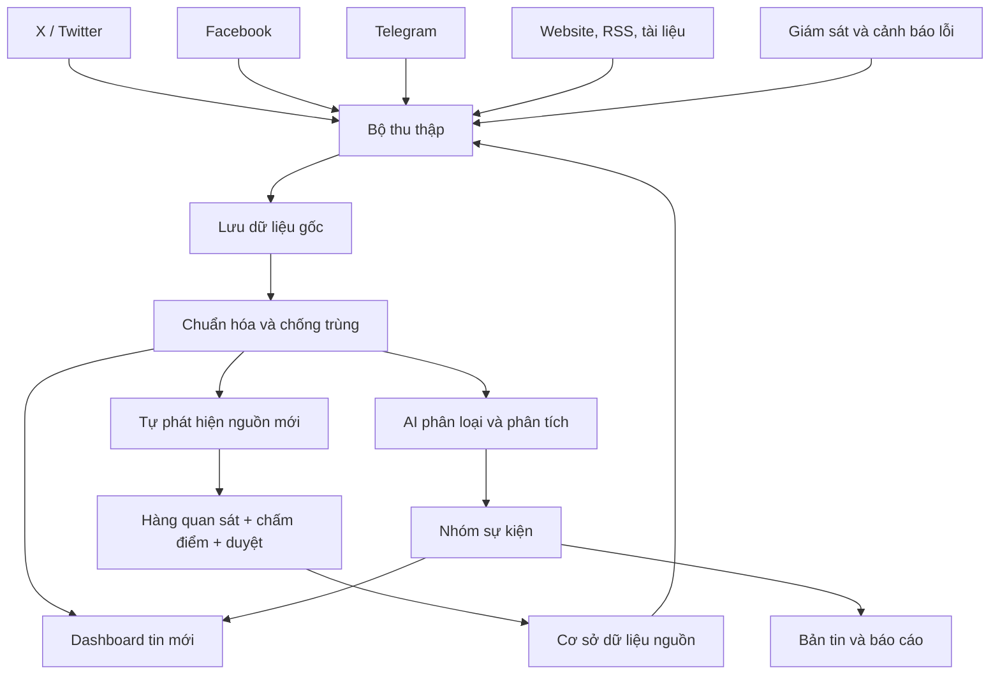

# OSINT Dashboard 1.0 — Thẩm định & kiến trúc đề xuất

Tài liệu này là phần Claude Code phản hồi đề xuất nghiệp vụ: kiểm chứng tính khả thi, chọn công nghệ, chốt lộ trình. Trạng thái: **bản nháp chờ chủ dự án duyệt** (xem mục 10).

## 1. Kết luận thẩm định

Hướng đi đúng: **ingest thô trước, AI sau** (tách hai đường), **lưu bằng chứng tách khỏi sự kiện**, **xây theo giai đoạn**. Giữ nguyên ba nguyên tắc này.

Cần chỉnh/bổ sung:

| # | Điểm trong đề xuất | Vấn đề | Điều chỉnh |
|---|---|---|---|
| 1 | "6 phân hệ" | Văn bản chỉ nêu 5 nhiệm vụ, không liệt kê 6 phân hệ | Đề xuất 6 phân hệ ở mục 2 |
| 2 | "Tự tìm tài khoản/kênh mới và tự bổ sung vào diện theo dõi" | Tự thêm nguồn là cửa cho nhiễu và tin giả/chiến dịch thao túng thông tin; X/Facebook/Telegram không có API khám phá miễn phí | Nguồn mới vào hàng **quan sát (probation)**, chấm điểm, người duyệt mới lên diện chính thức. Tự động hóa việc *đề xuất*, không tự động hóa việc *chấp nhận* |
| 3 | "Phát hiện mọi bài đăng ngay khi thu thập" | Độ trễ phụ thuộc loại nguồn; X và Facebook không có đường truy cập ổn định, rẻ, hợp điều khoản; scrape trái điều khoản dịch vụ | Phân tầng nguồn theo phương thức truy cập (mục 4), đặt SLO độ trễ riêng cho từng tầng |
| 4 | "Đề xuất nhận định" bằng AI | Rủi ro AI khẳng định thông tin chưa kiểm chứng | Mọi nhận định phải kèm trích dẫn bằng chứng, nhãn độ tin cậy, tách "dữ kiện" khỏi "suy luận" |
| 5 | Thiếu | Không nhắc: lưu trữ bất biến bài gốc (bài bị xóa), điểm tin cậy nguồn, phân quyền/nhật ký truy cập, đo chất lượng | Bổ sung ở mục 2, 5, 7 |

Giới hạn trung thực (giữ nguyên lời đề xuất): hệ thống không thể phủ mọi thứ trên Internet; mục tiêu là tối đa độ bao phủ và tối thiểu độ trễ **trong phạm vi nguồn truy cập hợp pháp, khả dụng**. Nên đo và công bố độ bao phủ thực tế trên bộ nguồn chuẩn.

## 2. Sáu phân hệ

1. **Collector** — thu thập đa phương thức, chạy độc lập từng nguồn, ghi bản ghi thô.
2. **Source Registry & Discovery** — danh mục nguồn, tầng ưu tiên, điểm tin cậy, sức khỏe nguồn, đề xuất nguồn mới.
3. **Evidence Store** — lưu bất biến: nội dung thô, snapshot trang (WARC/HTML), media, hash, thời điểm thu thập.
4. **Dedup & Event Clustering** — chống trùng nhiều lớp, gom bằng chứng thành nhóm sự kiện.
5. **AI Analysis** — dịch, phân loại, tóm tắt, trích xuất thực thể/dữ kiện, nhận định có dẫn chứng.
6. **Dashboard & Reporting** — luồng tin, nhóm sự kiện, tìm kiếm, cảnh báo, bản tin 07:00/11:00/18:00, báo cáo chuyên đề.

Giám sát & cảnh báo lỗi là tính năng xuyên suốt, không tính là phân hệ riêng.

## 3. Sơ đồ luồng dữ liệu

Sơ đồ nghiệp vụ của chủ dự án được giữ làm gốc; phần in đậm là chỗ Claude Code bổ sung.



Điểm khác sơ đồ gốc:

- **Hàng quan sát (P)** chen giữa "Tự phát hiện nguồn mới" và "Cơ sở dữ liệu nguồn": nguồn mới chỉ được theo dõi thử ở mức thấp, tích lũy điểm tin cậy/độ liên quan, rồi người duyệt mới lên diện chính thức.
- **Lưu dữ liệu gốc (F)** phải bất biến và chạy ngay sau thu thập; hiển thị lên dashboard không phụ thuộc AI.
- **Nhóm sự kiện (L)** chạy sau phân tích AI và embedding, nhưng dashboard (H) vẫn nhận tin thô từ G trước đó. Tin hiện ở trạng thái "chưa phân tích" rồi được làm giàu dần.
- **Giám sát (N)** theo dõi cả Collector lẫn *từng nguồn* (nguồn im lặng bất thường), không chỉ tiến trình.

Luồng tuần tự:

```
Nguồn ─► Collector ─► raw_item (lưu ngay, hiển thị ngay)
                          │
                          ├─► Dedup lớp 1-2 (đồng bộ, rẻ)  ─► evidence + event_group tạm
                          │
                          └─► hàng đợi ─► Embedding ─► Cluster sự kiện (lớp 3)
                                      └─► AI Analysis (dịch/phân loại/tóm tắt/trích xuất)
                                                    └─► Dashboard, cảnh báo, bản tin
```

## 4. Thu thập và độ trễ

| Tầng | Phương thức | Ví dụ | Độ trễ mục tiêu |
|---|---|---|---|
| A — đẩy/thời gian thực | Telegram MTProto (kênh công khai), Bluesky Jetstream, Mastodon streaming, WebSub | Kênh Telegram quân sự | giây → < 1 phút |
| B — thăm dò thích ứng | RSS/Atom, sitemap, trang tin có HTML ổn định; conditional GET (ETag/Last-Modified) | Bộ/ngành quốc phòng, báo quốc phòng, think tank | 1–5 phút theo tần suất đăng của từng nguồn |
| C — thăm dò nặng | Trang cần JS (Playwright), PDF/thông cáo | Thông cáo, báo cáo | 5–30 phút |
| D — API thương mại/khám phá | GDELT, API tin tức, API X nếu có ngân sách | Phát hiện nguồn mới, phủ rộng | tùy nhà cung cấp |

- Chu kỳ thăm dò **thích ứng**: nguồn đăng dày thì hỏi dày, nguồn thưa thì thưa; có jitter, backoff, tuân thủ robots.txt và giới hạn tốc độ.
- **Telegram**: khả thi nhất trong ba mạng xã hội trong sơ đồ (kênh công khai qua MTProto, nhận cập nhật đẩy). Thư viện hiện ở chế độ bảo trì nên phải cách ly sau một lớp giao diện, xem mục 7.
- **X/Twitter**: không có đường vào ổn định, miễn phí và hợp điều khoản. Chỉ khả thi bền vững nếu mua API; còn lại dùng kênh phản chiếu (Telegram/Bluesky/trang tin).
- **Facebook**: Graph API chỉ cho phép trang mình quản trị; trang/nhóm công khai của bên khác gần như không có API chính thức, scrape trái điều khoản và hay bị khóa. Đề xuất: **không đưa Facebook vào GĐ1**, xem là nguồn "best effort" có thể thêm sau (nhập thủ công/liên kết do người dùng gửi, hoặc nhà cung cấp dữ liệu thương mại nếu chấp nhận chi phí và rủi ro pháp lý).
- Không dùng tài khoản giả/né cơ chế chống bot. Chỉ nội dung công khai.

## 5. Chống trùng và liên kết sự kiện

Ba lớp, mỗi bằng chứng đều được giữ lại:

1. **Chính xác**: chuẩn hóa URL (bỏ tham số theo dõi), hash nội dung.
2. **Gần trùng**: SimHash/MinHash trên văn bản đã chuẩn hóa — bắt đăng lại, dịch lại nhẹ, cắt xén.
3. **Ngữ nghĩa**: embedding đa ngữ (bge-m3 hoặc multilingual-e5) + pgvector, gom theo cửa sổ thời gian + thực thể (địa điểm, đơn vị, loại khí tài); đánh giá lại khi có bằng chứng mới.

Đã triển khai lớp 1–2 (`src/osint/dedup.py`, `simhash.py`): cùng URL chuẩn hóa, cùng nội dung (hash), hoặc SimHash 64-bit cách nhau ≤ 3 bit; khớp theo nội dung chỉ xét trong cửa sổ ±7 ngày và chỉ với nội dung từ 80 ký tự (SimHash: từ 40 từ), để tiêu đề ngắn kiểu "Daily briefing" không bị gộp. Tin chỉ có đoạn mở đầu được xét lại sau khi lấy được toàn văn.

Đo thực tế (293 bài dài từ 10 nguồn): 20 cặp trùng khớp hoàn toàn (khoảng cách 0), cặp khác nhau gần nhất cách ≥ 8 bit, nên ngưỡng 3 không gộp nhầm. Thử trên bài giả lập: thêm chân bài hoặc tiền tố "(Reuters)" vẫn bắt được; viết lại một phần (đổi một câu, cắt 10% cuối) cách 6–9 bit nên **không** bắt được. Việc đó thuộc lớp 3 (ngữ nghĩa). Ngưỡng được giữ thấp có chủ ý: gộp nhầm hai tin độc lập làm mất tín hiệu xác nhận độc lập, còn bỏ sót một bản trùng chỉ làm dư một dòng.

Giới hạn: khi hai bản có cùng giờ đăng (feed đồng bộ của cùng một nhóm báo), không phân biệt được bản nào đăng trước, nguồn gốc được chọn theo thứ tự thu thập.

Mô hình dữ liệu: `event_group 1—N evidence 1—1 raw_item`. Hiển thị một nhóm; mở ra thấy đủ 15 nguồn, thứ tự thời gian, **nguồn gốc (người đăng đầu tiên)** tách khỏi bản đăng lại — đây là tín hiệu tin cậy quan trọng nhất, tránh đếm 15 bản sao như 15 xác nhận độc lập.

## 6. Phân tích bằng AI

- **Không có ngân sách AI** nên mặc định chạy mô hình cục bộ miễn phí (Ollama hoặc tương đương), không gọi API trả phí. Lớp AI viết sau một giao diện `LLMProvider` để thay được nhà cung cấp (cục bộ, gói miễn phí có giới hạn, hoặc API trả phí nếu sau này có ngân sách) mà không sửa logic nghiệp vụ.
- Hạn chế cần chấp nhận: mô hình cục bộ trên CPU chậm; tóm tắt/nhận định kém hơn mô hình lớn; dịch đa ngữ kém ở ngôn ngữ ít tài nguyên. Giảm tải bằng cách **lọc rẻ trước, LLM sau**: phát hiện ngôn ngữ, từ khóa/bộ phân loại embedding nhỏ để loại tin không liên quan; LLM chỉ chạy ở cấp *nhóm sự kiện*, không chạy trên từng bài.
- Embedding: bge-m3 hoặc multilingual-e5 chạy cục bộ trên CPU (đủ cho giai đoạn đầu). Dịch: NLLB-200 / Opus-MT cục bộ, ưu tiên khi nguồn không phải tiếng Anh.
- Bản tin tiếng Việt vẫn do mô hình sinh; chất lượng cần người duyệt kiểm tra, nhất là thuật ngữ quân sự.
- Đầu ra có cấu trúc (JSON schema): loại sự kiện, thực thể, địa điểm, thời gian, khí tài/đơn vị, mức độ chắc chắn.
- Quy tắc nhận định: tách **Dữ kiện** (có trích dẫn id bằng chứng) / **Đánh giá** (suy luận, nêu giả định) / **Khoảng trống thông tin**. Không có trích dẫn thì không được đưa vào bản tin.
- Thang tin cậy theo chuẩn tình báo (độ tin cậy nguồn × độ tin cậy thông tin, kiểu Admiralty) kèm cờ: chưa xác minh, nguồn đơn, nghi thao túng/tuyên truyền.
- Bản tin 07:00/11:00/18:00: tác vụ định kỳ lấy các nhóm sự kiện mới/đáng chú ý trong cửa sổ trước đó; người duyệt trước khi phát hành.

## 7. Công nghệ đề xuất (giai đoạn đầu: tối giản, một máy chủ)

| Lớp | Chọn | Lý do / ghi chú |
|---|---|---|
| Ngôn ngữ backend | Python 3.12 | Hệ sinh thái thu thập/NLP |
| API | FastAPI | Nhẹ, kiểu dữ liệu rõ |
| CSDL | **PostgreSQL 16 + pgvector** | Một CSDL cho dữ liệu, tìm toàn văn, vector, hàng đợi; đủ cho giai đoạn đầu |
| Hàng đợi | Postgres (`FOR UPDATE SKIP LOCKED`) → Redis Streams/NATS khi cần | Chưa cần Kafka; tránh vận hành thừa |
| Tìm kiếm | Postgres FTS → Meilisearch/OpenSearch nếu vượt tải | Đa ngữ, có thể thêm sau |
| Trích xuất nội dung | feedparser, trafilatura (Apache-2.0), Playwright (khi bắt buộc) | Không dùng news-please: repo đã bị archive 15/10/2026 |
| Trang không có RSS | RSSHub (AGPL-3.0) chạy như dịch vụ riêng | Không nhúng mã vào dự án để tránh ràng buộc AGPL |
| Telegram | Telethon (MIT) lấy từ Codeberg/PyPI; dự phòng: fork Pyrogram (Kurigram/Pyrofork) | Repo GitHub của Telethon đã archive 21/02/2026 và chuyển sang Codeberg. Bọc sau một lớp giao diện riêng để thay thư viện khi cần |
| Bluesky | Jetstream chính thức (WebSocket JSON) | Máy chủ mã nguồn mở bằng Go, có endpoint công cộng |
| Tham khảo thiết kế | Taranis AI (EUPL-1.2), World Monitor (AGPL-3.0) | Chỉ tham khảo mô hình dữ liệu/giao diện; chưa dùng làm nền |
| Lưu thô/media/snapshot | Hệ tệp → MinIO/S3 | Nội dung bất biến, đặt tên theo hash |
| Lập lịch | worker riêng + bảng `source_schedule` | Cần chu kỳ thích ứng theo từng nguồn |
| Giao diện | Next.js (React) + TypeScript | Luồng tin, nhóm sự kiện, bản đồ về sau |
| Triển khai | Docker Compose trên 1 VPS, healthcheck, sao lưu hằng ngày | 24/7; mở rộng sau |
| Giám sát | Prometheus + Grafana nhẹ, cảnh báo "nguồn im lặng bất thường" | Nguồn chết âm thầm là rủi ro số một |
| Bảo mật | Đăng nhập, phân quyền, nhật ký truy cập, khóa API trong secret store | Nội dung nghiệp vụ nhạy cảm |

Chỉ số đo từ ngày đầu: độ trễ phát hiện p50/p95 theo tầng nguồn; độ bao phủ trên bộ nguồn chuẩn; tỷ lệ trùng bị chặn; tỷ lệ nguồn lỗi; chi phí AI trên mỗi nhóm sự kiện.

## 8. Lộ trình theo giai đoạn

| GĐ | Nội dung | Tiêu chí hoàn thành |
|---|---|---|
| 0 | Khung dự án, CSDL, Source Registry, CI, Docker Compose | Chạy được trên 1 máy, có migration & kiểm thử |
| 1 | Collector RSS/web (tầng B), Evidence Store, dashboard luồng tin, giám sát nguồn | 50–100 nguồn chạy 24 giờ liên tục, đo được độ trễ. **Đã làm:** collector, snapshot, dashboard, `osint stats`, thử 10 nguồn thật. **Chưa:** cảnh báo nguồn im lặng, chạy 24 giờ, mở rộng lên 50–100 nguồn |
| 2 | Telegram (tầng A), dedup lớp 1–2 | Đăng lại không tạo tin mới, giữ đủ bằng chứng. **Đã làm:** dedup lớp 1–2 và nhóm sự kiện, hiển thị trên dashboard. **Chưa:** Telegram |
| 3 | Embedding + gom nhóm sự kiện, nguồn gốc vs đăng lại | Nhóm sự kiện hiển thị đúng trên bộ mẫu có gán nhãn |
| 4 | AI Analysis (dịch, phân loại, tóm tắt, trích xuất) | Đầu ra có cấu trúc, có trích dẫn, đo độ chính xác trên bộ mẫu |
| 5 | Bản tin 07:00/11:00/18:00, báo cáo chuyên đề | Bản nháp tự sinh, người duyệt phát hành |
| 6 | Khám phá nguồn mới (probation), điểm tin cậy nguồn; X/Facebook nếu được duyệt | Đề xuất nguồn có lý do, duyệt một chạm |

## 9. Rủi ro chính

- **Điều khoản nền tảng** (X, Facebook): quyết định sớm để không xây trên đường truy cập sẽ bị chặn.
- **Tin giả/thao túng thông tin** trong lĩnh vực quân sự: đếm bản sao như xác nhận độc lập sẽ làm sai lệch nhận định.
- **Nguồn chết âm thầm** hoặc đổi cấu trúc trang: cần kiểm tra sức khỏe từng nguồn.
- **Bài bị xóa/sửa**: lưu snapshot ngay khi thu thập.
- **Chi phí AI** tăng theo khối lượng: lọc trước bằng mô hình nhỏ, chỉ tổng hợp ở cấp nhóm sự kiện.

## 10. Quyết định của chủ dự án

| Vấn đề | Quyết định | Hệ quả |
|---|---|---|
| X/Twitter | Dùng kênh phản chiếu, không mua API | Không có Collector X; theo dõi nội dung X thông qua Telegram/Bluesky/trang tin |
| Ngôn ngữ nguồn | Tất cả ngôn ngữ, **ưu tiên tiếng Anh** | Phát hiện ngôn ngữ ngay khi thu thập; nguồn tiếng Anh vào trước; dịch ở GĐ4 |
| Ngân sách | Không có | Công cụ miễn phí/mã nguồn mở; AI chạy cục bộ (mục 6); hạ tầng tối thiểu |

Chưa được trả lời, đang dùng giả định (đổi được):

- **Facebook**: hoãn khỏi GĐ1, chỉ nhận liên kết nhập thủ công.
- **Hạ tầng**: một máy chạy Docker Compose, chưa ràng buộc nơi lưu trữ.
- **Ngôn ngữ đầu ra**: tiếng Việt.
- **Người dùng**: một nhóm nhỏ, chưa cần phân quyền theo chuyên đề.
- **Nguồn ban đầu**: chưa có danh sách; GĐ1 sẽ dùng bộ nguồn mẫu công khai (báo quốc phòng, think tank, bộ quốc phòng các nước, tiếng Anh) để đo độ trễ, và thay bằng danh sách của chủ dự án khi có.
